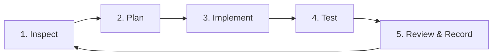

# Loop Engineering Process Template

OpenReview AI is developed using strict **Loop Engineering** principles. Every feature, bug fix, or security enhancement proceeds through an iterative, gated 5-step loop.

---

## The 5-Step Loop



### 1. Inspect
- Review requirements in `07_TASK_BACKLOG.md` and `06_IMPLEMENTATION_PLAN.md`.
- Inspect existing code, types, and architectural decisions in `docs/ADR.md`.
- Verify the current test suite state (`.venv/bin/pytest`) before introducing changes.

### 2. Plan
- Define minimal-viable diff and clear boundary requirements.
- Identify affected files, new interfaces, and data models.
- Plan negative test cases (malformed input, timeouts, edge cases, attack strings).

### 3. Implement
- Write clean, modular, typed Python code.
- Enforce strict typing (`from __future__ import annotations`, dataclasses, enums).
- Never use `shell=True` for subprocess calls.
- Quarantine AI outputs (`origin: ai`, `status: unverified`).

### 4. Test
- Run automated tests (`.venv/bin/pytest`).
- Validate protocol conformance, boundary conditions, and error recovery.
- Confirm 100% pass rate with zero regressions.

### 5. Review & Record
- Update `PROGRESS.md` with:
  - Loop number and task ID.
  - Files modified or added.
  - Concrete commands run and exit codes.
  - Key findings, architectural notes, and verification evidence.
- Mark completed tasks in `07_TASK_BACKLOG.md`.

---

## Loop Entry / Exit Checklist

| Phase | Entry Condition | Exit Gate |
|---|---|---|
| **E0: Audit & Foundation** | Unaudited repo | Architecture decisions and license inventory documented |
| **E1: CLI Skeleton** | Empty package | CLI flags, config loading, Git root detection tested |
| **E2: Diff & Schema** | Raw repository | Diff parser, Finding v1.0 schema, and golden fixtures verified |
| **E3: Deterministic Scanners** | No linters | Ruff & ESLint adapters with timeout caps and missing-tool guards |
| **E4: Optional Local AI** | Static only | Ollama adapter, secret redaction, hallucination filter, static fallback |
| **E5: Quality & Safety** | Unhardened app | Path traversal defense, secret-redacting logger, performance baseline, and seeded E2E evaluation |

---

## Template for `PROGRESS.md` Entries

```markdown
### Loop <N> --- <Epic-Task-ID>: <Title>

- **Tasks completed:** <Task IDs>
- **Files changed:**
  - `<file_path>` (<brief description of changes>)
- **Commands run:**
  - `.venv/bin/pytest`: Exit code 0 (<N> passed).
- **Key findings:**
  - <Core architectural invariants confirmed>
- **Not verified / Blockers:** None.
- **Next task:** <Next Task ID>
```
