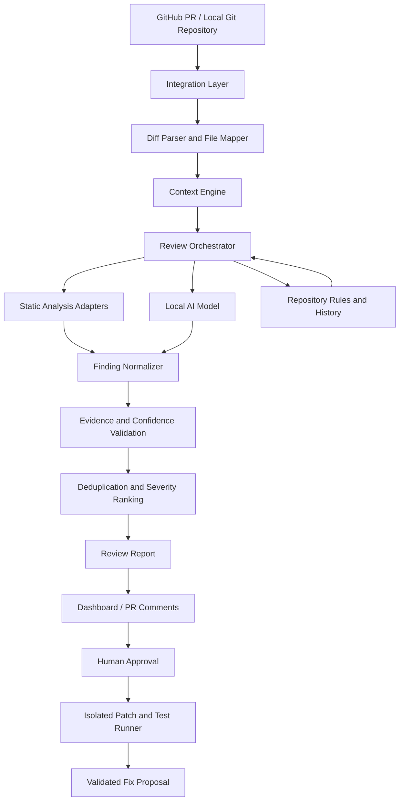

# Complete Review Architecture Pipeline

## 1. End-to-End Flowchart

---

## 2. Component Mapping to Implementation

| Node | Architecture Node Name | Implementation Module | Description & Guarantees |
| :---: | :--- | :--- | :--- |
| **A** | **GitHub PR / Local Git Repository** | `openreview.repo.diff_models.DiffRequest` | Input source: Git working-tree, staged diff, or base/head commit range. |
| **B** | **Integration Layer** | `openreview.integrations` & `openreview.repo.git` | HMAC-SHA256 GitHub webhook verification, queue worker, and safe git root detection. |
| **C** | **Diff Parser and File Mapper** | `openreview.repo.diff_parser` | Parses unified diffs into structured `FileDiff` models. Maps added, modified, renamed, deleted, and binary assets. |
| **D** | **Context Engine** | `openreview.review.context` & `openreview.security.redaction` | Extracts bounded changed code chunks with padding and token budgeting. Permanently masks secrets with `[REDACTED_SECRET]`. |
| **E** | **Review Orchestrator** | `openreview.review.orchestrator.CompleteReviewOrchestrator` | Central execution engine coordinating linters, local AI, and repo history. |
| **F** | **Static Analysis Adapters** | `openreview.adapters` (Ruff, ESLint, REA) | Deterministic linters executed offline via explicit argument vectors. **REA Adapter** provides deep binary inspection for `.so`, `.wasm`, `.dylib`, `.node`. |
| **G** | **Local AI Model** | `openreview.adapters.ollama` | Optional air-gapped local LLM (`qwen2.5-coder:7b`) receiving redacted context. All findings labeled `status: unverified`. |
| **H** | **Repository Rules & History** | `openreview.review.rules_and_history` | Discovers `.openreview.toml`, `REVIEW_GUIDELINES.md`, `.cursorrules`, and reads recent git commit log (`git log -n 5`) for historical context. |
| **I** | **Finding Normalizer** | `openreview.review.normalizer.FindingNormalizer` | Normalizes heterogeneous diagnostics and AI JSON into standardized `Finding` objects with deterministic SHA256 IDs. |
| **J** | **Evidence & Confidence Validation** | `openreview.review.evidence_validator` | Verifies line numbers fall strictly within changed diff hunks (`is_line_in_diff_hunks`). Filters hallucinations and assigns confidence scores. |
| **K** | **Deduplication & Severity Ranking** | `openreview.review.deduplicator` | Deduplicates overlapping findings. Ranks findings in strict severity order: `CRITICAL` &rarr; `WARNING` &rarr; `INFO` &rarr; `STYLE`. |
| **L** | **Review Report** | `openreview.schemas.models.ReviewReport` | Versioned schema v1.0. Renders reproducible JSON and human-readable Markdown summaries. |
| **M** | **Dashboard / PR Comments** | `openreview.integrations.inline_comments` | Filters comments strictly within diff hunks to eliminate GitHub API 422 errors. Routes review events (`APPROVE`, `REQUEST_CHANGES`, `COMMENT`). |
| **N** | **Human Approval** | `openreview.patch.models` & `applier` | **ADR-005 Invariant:** Autonomous systems must never auto-commit code. Explicit approval (`approved=True`) is mandatory. |
| **O** | **Isolated Patch & Test Runner** | `openreview.patch.sandbox.SandboxPatchTester` | Tests proposed patches in disposable isolated workspaces with scanner timeout and buffer limits. |
| **P** | **Validated Fix Proposal** | `openreview.patch.generator` | Generates standard unified `.patch` files ready for manual export or working tree application. |

---

## 3. REA (Reverse Engineering Assistant) Integration

In accordance with **ADR-006**, OpenReview AI integrates REA as a specialized static analysis adapter:
- **Location:** `src/openreview/adapters/rea.py` (`ReaAdapter`).
- **Engine:** Sibling REA framework at `/Users/vivek/Desktop/untitled folder 2/rea` (`scripts/rea.mjs`).
- **Target Assets:** Compiled binaries, WebAssembly (`.wasm`), shared libraries (`.so`, `.dylib`), native Node addons (`.node`), and bytecode.
- **Graceful Degradation:** If REA is not installed or no binary assets are changed in a PR, the adapter safely skips with zero overhead and zero runtime dependency.
